# Give AI a Brain. Building a Shared Semantic Foundation for AI Agents and Databricks Genie
AI can write code, generate SQL, and answer business questions. But does it truly understand your data platform — its architecture, data flows, business concepts, and metrics?
As AI becomes an integral part of Data Engineering and Analytics, the real challenge is no longer just choosing the right model. It's building the right context and semantic foundation behind it.
In this session, we'll explore two sides of the same challenge.

## Part 1 — AI for Data Engineers
Discover how architecture documentation, C4 models, code-derived data lineage, ontology, coding standards, and agent-driven workflows such as BMAD can transform an existing Databricks project into an AI-ready development environment.
We'll show how structured knowledge helps AI agents navigate complex data pipelines, understand dependencies, and implement features consistently with existing engineering standards.

## Part 2 — AI for Data Analysts
We'll take the same knowledge beyond the code and into Databricks' evolving semantic ecosystem: Unity Catalog, Metric Views, Domains, Pages, Genie Ontology, Genie One, and Genie Code.
Explore how business definitions, trusted metrics, and data relationships can provide AI with the context needed to generate more accurate, consistent, and explainable analytical answers.
The key message: AI for engineers and AI for analysts shouldn't operate with two different understandings of the same data platform.
The future of AI-ready data platforms is not just about better prompts or smarter models. It's about building a shared, governed semantic foundation that connects code, data, and business meaning.


---

## About this repository

This repository is the working demo for the talk. It builds one governed semantic
foundation on Databricks and shows both audiences consuming it. The sample data is the
public TPC-DS **store sales** dataset (`samples.tpcds_sf1` by default), so the demo runs on
a Databricks Free Edition workspace.

### What is built

| Layer | What it is | Where |
|---|---|---|
| Pipeline | Medallion (bronze → silver → gold) in declarative SQL, as Lakeflow Declarative Pipelines, one per module | `src/{module}/{bronze,silver,gold}` |
| Deployment | Databricks Asset Bundle that deploys the pipelines and the build-and-document job | `databricks.yml`, `resources/` |
| Metric Views | Governed Metric Views; each business metric defined once, created in Unity Catalog with SQL `CREATE VIEW ... WITH METRICS` | `docs/reference/metrics_views/` |
| Pages | Genie Knowledge Pages; one governed business term each, applied through the Knowledge Pages API | `docs/reference/pages/` |
| Domains | Business-domain registry; every gold table and Metric View mapped to one subdomain, applied as Databricks Domains through the Domains API | `docs/domains/README.md` |
| Documentation | C4 architecture and a Palantir-style ontology folded into the gold table files | `docs/` |

### The data model

The fact is `store_sales` — one row per ticket line (`ticket_number` × `item_key`). It is
surrounded by conformed dimensions: customer (with address), item, store, date, and
promotion. The governed Metric Views read the gold `fct_*`/`dim_*` star schema directly,
joined on surrogate keys, so no pre-joined copy of the star schema exists to drift from it.

### The through-line

One business term keeps one name across every layer: the silver columns, the gold star
schema, the Metric Views, the ontology, the Genie Knowledge Pages, and Genie. That single
vocabulary is the shared foundation — engineers and analysts read the same meaning of the
same data.

- **Part 1 (engineers):** the medallion pipeline, the dimensional model, and the governed
  Metric View, documented in C4, ontology, and a governed metric definition.
- **Part 2 (analysts):** the governed Metric Views, the Genie Knowledge Pages, and the Unity
  Catalog **Domains**, all reading the same governed gold model.

### Run it

```bash
# Authenticate to your workspace (one browser sign-in)
databricks auth login --host <your-workspace-url> --profile <name>

# Deploy to a workspace and run the pipeline (targets: meetup, free)
databricks bundle deploy --target meetup
databricks bundle run store_sales --target meetup
```

The Metric View (`docs/reference/metrics_views/`) is a Unity Catalog object, not a bundle
resource; its reference file carries the definition the deploy creates it from.

### Good to know

- **Source data:** the `source_schema` bundle variable (`databricks.yml`) picks the TPC-DS
  schema. Default `samples.tpcds_sf1` (1 GB) builds on Free Edition. Set it to
  `samples.tpcds_sf1000` (1 TB) for realistic volume when the workspace has the capacity.
  The pipeline reads it as the `${source_schema}` configuration, so no SQL changes.
- **Deploy location:** the `dev` target deploys to the shared folder
  `/Workspace/Shared/dbx_meetup_demo/${bundle.target}` (and grants the `users` group manage
  access), so the owner can share the demo with other workspace users. `${bundle.target}`
  keeps `dev` separate from any other target.
- **Catalog:** the medallion targets the `workspace` catalog, the one writable catalog in
  Free Edition. Change it in `databricks.yml`.
- **Metric Views join on surrogate keys:** each Metric View reads a gold `fct_*`/`dim_*`
  table and declares its dimension joins with explicit `on:` expressions, not `using` keys.
  Genie reads the `store_sales_metrics` Metric View.
- **Governance:** `email_address` stops at silver; only business-safe columns reach gold.

## How the documentation works

The `docs/` tree is the source of truth, kept in Git. It follows the C4 model: context
(L1), modules (L2), components (L3), and reference files (L4), plus a cross-cutting
`domains/` governance registry. Each definition deploys to the workspace by the path that
fits it: the Asset Bundle (Lakeflow pipeline) builds the gold tables, SQL creates the Metric
Views, and the Databricks REST APIs apply the Domains and the Genie Knowledge Pages. The gold
tables, Metric Views, domain tags, and Genie pages all converge into one **ontology** — the
shared semantic foundation Genie reads.

```mermaid
%%{init: {"theme": "base", "themeVariables": {"fontfamily": "Segoe UI, Helvetica, Arial, sans-serif", "fontSize": "14px", "primaryColor": "#eef2ff", "lineColor": "#64748b", "clusterBorder": "#cbd5e1"}, "flowchart": {"curve": "basis", "nodeSpacing": 45, "rankSpacing": 70}}}%%
flowchart LR
  subgraph DOCS["📘 &nbsp;docs/ &mdash; C4 knowledge &middot; source of truth in Git"]
    direction TB
    L1["L1 &middot; README.md<br/><b>system context</b>"]
    L2["L2 &middot; modules/<br/>one file per pipeline module"]
    L3["L3 &middot; components/{module}/<br/>bronze &middot; silver &middot; gold &middot; metrics"]
    TBL["L4 &middot; reference/tables/<br/>gold schemas = ontology objects"]
    MV["L4 &middot; reference/metrics_views/<br/>governed metric defs + YAML"]
    PG["L4 &middot; reference/pages/<br/>business terms + synonyms"]
    DOM["🛡️ domains/<br/>gold table &rarr; subdomain tag_key"]
    L1 --> L2 --> L3
    L3 --> TBL & MV
    MV --> PG
    TBL -. governed by .-> DOM
  end

  subgraph DBX["⚡ &nbsp;Databricks &mdash; governed runtime &middot; deployed by bundle, SQL, and API"]
    direction TB
    GOLD["🟡 Gold star schema<br/>fct_* / dim_* in Unity Catalog<br/><i>COMMENT domain= marker</i>"]
    MVIEW["📐 Metric Views (UC objects)<br/>carry real UC domain tag"]
    DOMAIN["🏷️ Databricks Domains<br/>Retail Analytics / Sales &middot; Returns &middot; Shared"]
    PAGES["📄 Genie Knowledge Pages"]
  end

  ONT(["🧠 <b>Ontology &mdash; shared semantic foundation</b><br/>object types + links &middot; one name for one thing"])
  GENIE(["💬 <b>Databricks Genie</b><br/>trusted, explainable answers"])

  TBL ==>|Asset Bundle · Lakeflow pipeline| GOLD
  MV ==>|SQL · CREATE VIEW WITH METRICS| MVIEW
  DOM ==>|Domains API| DOMAIN
  PG ==>|Knowledge Pages API| PAGES
  DOMAIN -. applies UC tag .-> MVIEW

  GOLD ==> ONT
  MVIEW ==> ONT
  DOMAIN ==> ONT
  PAGES ==> ONT
  ONT ==> GENIE

  classDef docs fill:#eef2ff,stroke:#6366f1,stroke-width:1px,color:#1e1b4b;
  classDef dbx fill:#ecfeff,stroke:#06b6d4,stroke-width:1px,color:#083344;
  classDef ont fill:#fff7ed,stroke:#f97316,stroke-width:2px,color:#7c2d12;
  classDef genie fill:#f0fdf4,stroke:#22c55e,stroke-width:2px,color:#14532d;
  class L1,L2,L3,TBL,MV,PG,DOM docs;
  class GOLD,MVIEW,DOMAIN,PAGES dbx;
  class ONT ont;
  class GENIE genie;
  style DOCS fill:#f8faff,stroke:#c7d2fe,stroke-width:1px;
  style DBX fill:#f5feff,stroke:#a5f3fc,stroke-width:1px;
```



- **Left (Part 1, engineers):** the C4 docs tree. L1 context → L2 modules → L3 components →
  L4 reference files. The `domains/` registry is a cross-cutting governance layer: it maps
  each L4 gold table to one business subdomain, not the L3 component.
- **The `==>` arrows (deploy) show how each object reaches the workspace:** the Asset Bundle
  (Lakeflow pipeline) builds the gold tables; the Metric Views are created with SQL
  (`CREATE VIEW ... WITH METRICS`); the Domains and the Genie Knowledge Pages are applied
  through the Databricks REST APIs.
- **Right into the ontology (Part 2, analysts):** gold objects, Metric Views, domain tags,
  and pages converge into the shared semantic foundation Genie reads — the talk's
  through-line.
