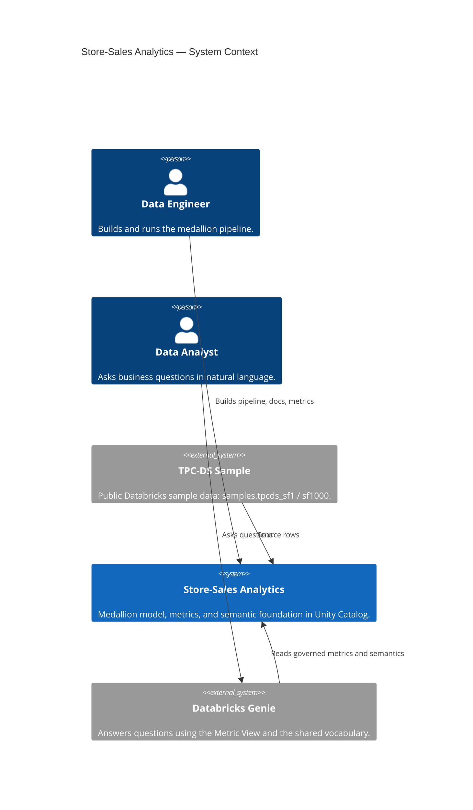

# Store-Sales Analytics — Documentation (L1 — System Context)

↓ [Modules](./modules/README.md) &nbsp;|&nbsp; [Ontology](./ontology/README.md) &nbsp;|&nbsp; [Doc standard](./engineering/documentation-standard.md)

> **C4 Level 1 — System Context.** One governed semantic foundation on the public TPC-DS store-sales dataset, shared by data engineers who build the pipeline and data analysts who ask Genie.

This documentation follows the C4 model. Load top-down: this page for context, a module
(L2) for a container, a component (L3) to implement a feature, a reference file (L4) for
exact column names or the governed metric definition. The rules are in
[engineering/documentation-standard.md](./engineering/documentation-standard.md).

The point of the talk: the engineer and the analyst stand on **one** semantic foundation,
not two separate understandings of the same data. One business term keeps one name across
the silver columns, the gold star schema, the Metric View, the ontology, Genie, and the
dashboard.

## The documentation (C4 levels)

| Level | Where | What |
|---|---|---|
| L1 | this file | System context. |
| L2 | [modules/](./modules/README.md) | The pipeline and semantic containers. |
| L3 | [components/](./components/README.md) | Bronze, silver, gold, and the metrics component. |
| L4 | [reference/tables/](./reference/tables/README.md), [reference/metrics_views/](./reference/metrics_views/README.md) | Column schemas and the governed Metric View. |

## Other views

- [Ontology](./ontology/README.md) — the business objects, their properties, and links.
- [Documentation standard](./engineering/documentation-standard.md) — how these files are built.

## Data source and deployment

- **Source:** the `source_schema` bundle variable (`databricks.yml`) picks the TPC-DS
  schema. Default `samples.tpcds_sf1` (1 GB) builds on Databricks Free Edition; set
  `samples.tpcds_sf1000` (1 TB) for realistic volume.
- **Deploy location:** the `dev` target deploys to the shared folder
  `/Workspace/Shared/dbx_meetup_demo/${bundle.target}`, so the owner can share the demo
  with other workspace users.
