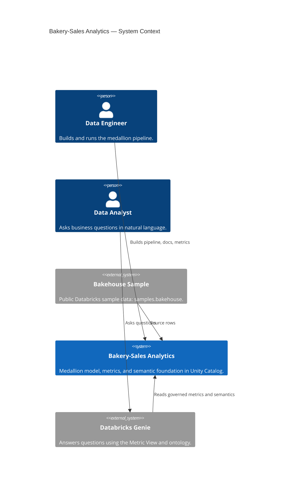

# C4 Level 1 — System Context

The bakery-sales analytics system turns the public bakehouse sample into a governed data
model that two audiences share: data engineers who build pipelines and data analysts
who ask business questions through Genie.

The point of the talk: the engineer and the analyst stand on **one** semantic
foundation, not two separate understandings of the same data.
