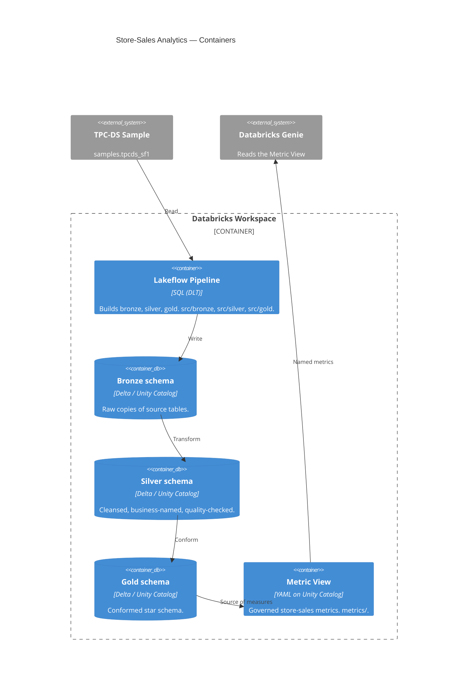

# C4 Level 2 — Containers

The system runs inside one Databricks workspace. Each container maps to a place in
this repository and an object in Unity Catalog.

The medallion layers are **separate Unity Catalog schemas** so the boundary stays
visible: raw, cleansed, conformed.
