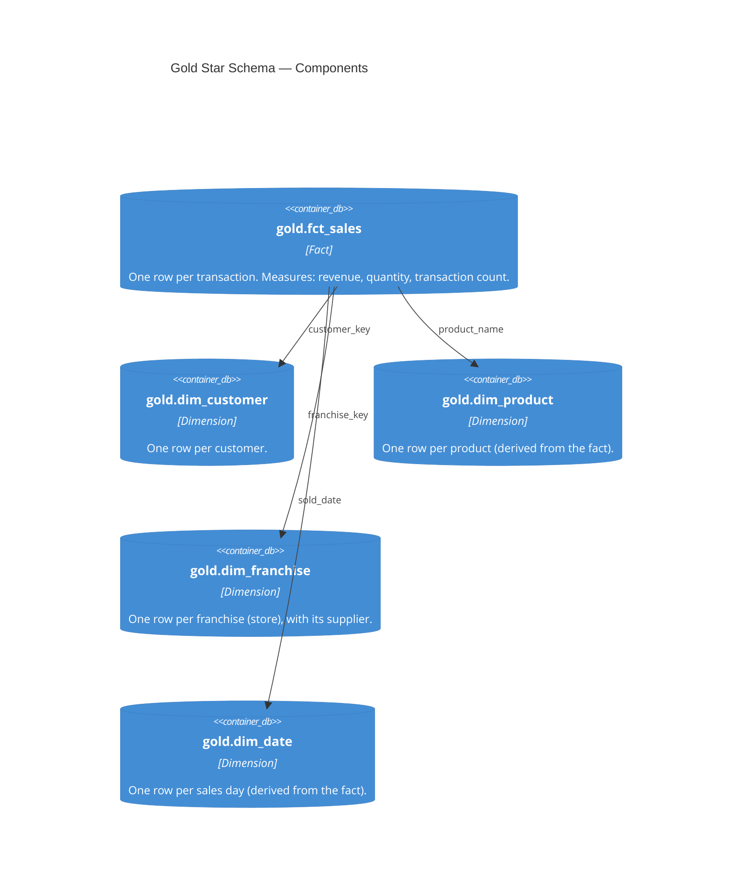

# C4 Level 3 — Components (Gold star schema)

Inside the gold schema the components form a classic star: one fact surrounded by
conformed dimensions. The Metric View reads the fact and joins the dimensions.

Each component is one SQL file in `src/gold/`. Product and date have no source table in
the sample, so the pipeline derives them from the fact. The foreign keys here are the
same links the ontology names (`docs/ontology/link-types.md`).
