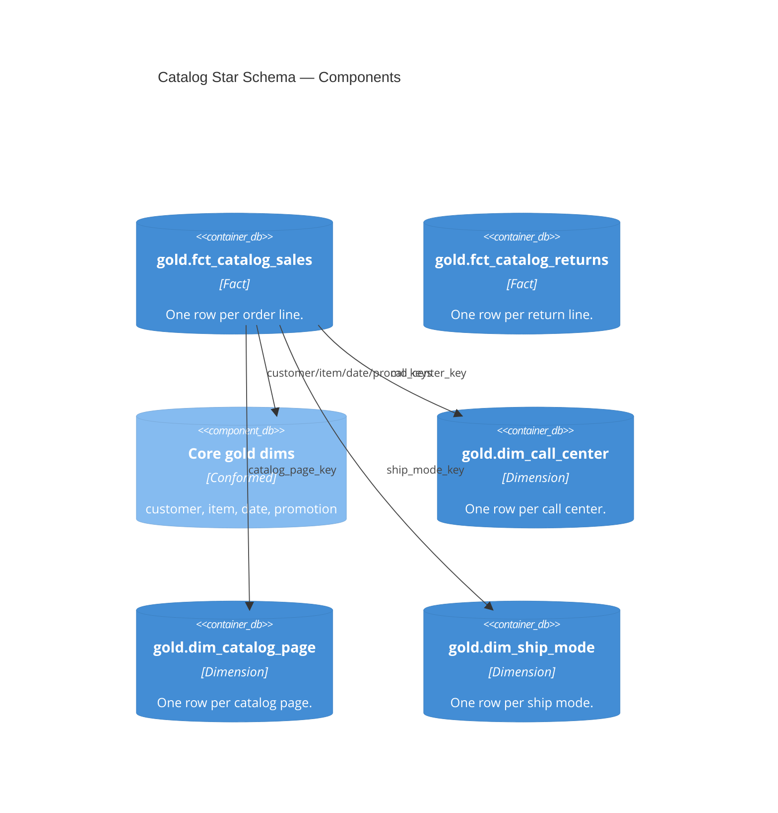

# Gold — Star Schema and Consumption Table (Catalog)

| module | component | entities | tables |
|---|---|---|---|
| [catalog_sales](../../modules/catalog_sales.md) | gold | FctCatalogSales · FctCatalogReturns · DimCallCenter · DimCatalogPage · DimShipMode · CatalogSalesEnriched | [gold.fct_catalog_sales](../../reference/tables/gold.fct_catalog_sales.md) · [gold.catalog_sales_enriched](../../reference/tables/gold.catalog_sales_enriched.md) |

> **C4 Level 3 — Component.** The catalog star schema (sales and returns facts, three catalog dims) plus the wide `catalog_sales_enriched` table the Metric View reads.

## Entities

| Entity | Table(s) | Algorithm(s) | Description |
|---|---|---|---|
| `FctCatalogSales` | [`gold.fct_catalog_sales`](../../reference/tables/gold.fct_catalog_sales.md) | — | Conformed sales fact. Grain: one order line. |
| `FctCatalogReturns` | [`gold.fct_catalog_returns`](../../reference/tables/gold.fct_catalog_returns.md) | — | Conformed returns fact. Grain: one return line. |
| `DimCallCenter` | [`gold.dim_call_center`](../../reference/tables/gold.dim_call_center.md) | — | Call-center dimension. |
| `DimCatalogPage` | [`gold.dim_catalog_page`](../../reference/tables/gold.dim_catalog_page.md) | — | Catalog-page dimension. |
| `DimShipMode` | [`gold.dim_ship_mode`](../../reference/tables/gold.dim_ship_mode.md) | — | Ship-mode dimension. |
| `CatalogSalesEnriched` | [`gold.catalog_sales_enriched`](../../reference/tables/gold.catalog_sales_enriched.md) | — | Sales fact widened with core dims and the catalog dims; read by the Metric View and Genie with no joins. |

Each entity is one SQL file in `src/catalog_sales/gold/`. The enriched table reads the core
gold dims across pipelines; the catalog dims are owned by this pipeline.
