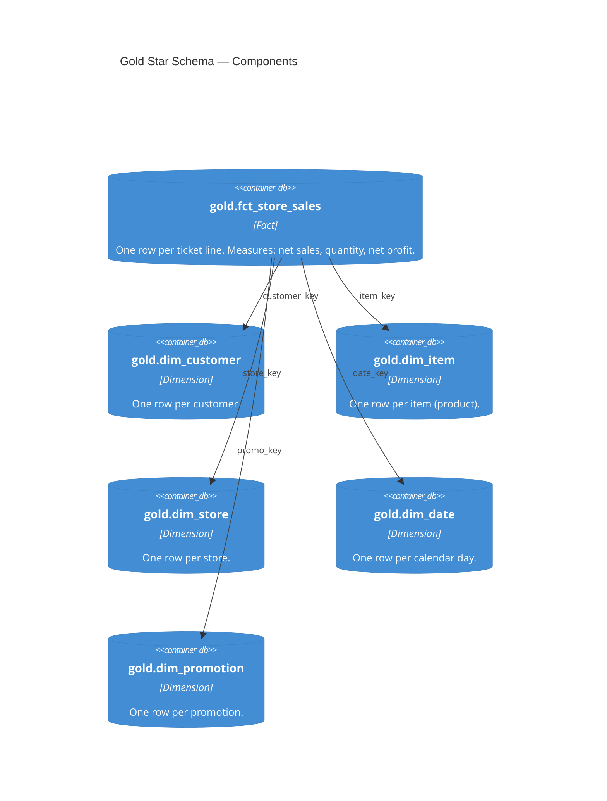

# Gold — Star Schema and Consumption Table

| module | component | entities | tables |
|---|---|---|---|
| [pipeline](../../modules/pipeline.md) | gold | FctStoreSales · DimCustomer · DimItem · DimStore · DimDate · DimPromotion · StoreSalesEnriched | [gold.fct_store_sales](../../reference/tables/gold.fct_store_sales.md) · [gold.store_sales_enriched](../../reference/tables/gold.store_sales_enriched.md) |

> **C4 Level 3 — Component.** The conformed star schema (one fact, five dimensions) plus the wide `store_sales_enriched` table the semantic layer reads.

## Entities

| Entity | Table(s) | Algorithm(s) | Description |
|---|---|---|---|
| `FctStoreSales` | [`gold.fct_store_sales`](../../reference/tables/gold.fct_store_sales.md) | — | Conformed fact. Grain: one ticket line. |
| `DimCustomer` | [`gold.dim_customer`](../../reference/tables/gold.dim_customer.md) | — | Customer dimension; business-safe columns only. |
| `DimItem` | [`gold.dim_item`](../../reference/tables/gold.dim_item.md) | — | Item (product) dimension. |
| `DimStore` | [`gold.dim_store`](../../reference/tables/gold.dim_store.md) | — | Store dimension. |
| `DimDate` | [`gold.dim_date`](../../reference/tables/gold.dim_date.md) | — | Calendar dimension. |
| `DimPromotion` | [`gold.dim_promotion`](../../reference/tables/gold.dim_promotion.md) | — | Promotion dimension. |
| `StoreSalesEnriched` | [`gold.store_sales_enriched`](../../reference/tables/gold.store_sales_enriched.md) | — | Fact widened with descriptive columns; read by the Metric View and Genie with no joins. |

Each entity is one SQL file in `src/gold/`. The star is the modeling source;
`store_sales_enriched` is the consumption table built from it. The foreign keys here are the
links the ontology names ([`docs/ontology/link-types.md`](../../ontology/link-types.md)).
