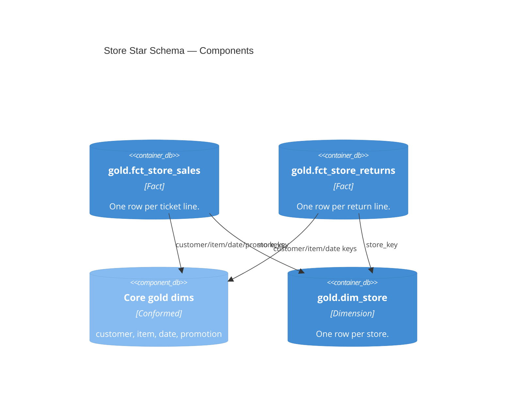

# Gold — Star Schema and Consumption Table (Store)

| module | component | entities | tables |
|---|---|---|---|
| [store_sales](../../modules/store_sales.md) | gold | FctStoreSales · FctStoreReturns · DimStore · StoreSalesEnriched | [gold.fct_store_sales](../../reference/tables/gold.fct_store_sales.md) · [gold.store_sales_enriched](../../reference/tables/gold.store_sales_enriched.md) |

> **C4 Level 3 — Component.** The store star schema (sales and returns facts, the store dimension) plus the wide `store_sales_enriched` table the Metric View reads.

## Entities

| Entity | Table(s) | Algorithm(s) | Description |
|---|---|---|---|
| `FctStoreSales` | [`gold.fct_store_sales`](../../reference/tables/gold.fct_store_sales.md) | — | Conformed sales fact. Grain: one ticket line. |
| `FctStoreReturns` | [`gold.fct_store_returns`](../../reference/tables/gold.fct_store_returns.md) | — | Conformed returns fact. Grain: one return line. |
| `DimStore` | [`gold.dim_store`](../../reference/tables/gold.dim_store.md) | — | Store dimension (store-domain only). |
| `StoreSalesEnriched` | [`gold.store_sales_enriched`](../../reference/tables/gold.store_sales_enriched.md) | — | Sales fact widened with core dims and the store dim; read by the Metric View and Genie with no joins. |

Each entity is one SQL file in `src/store_sales/gold/`. The enriched table reads the core
gold dims across pipelines; the store dimension is owned by this pipeline.
