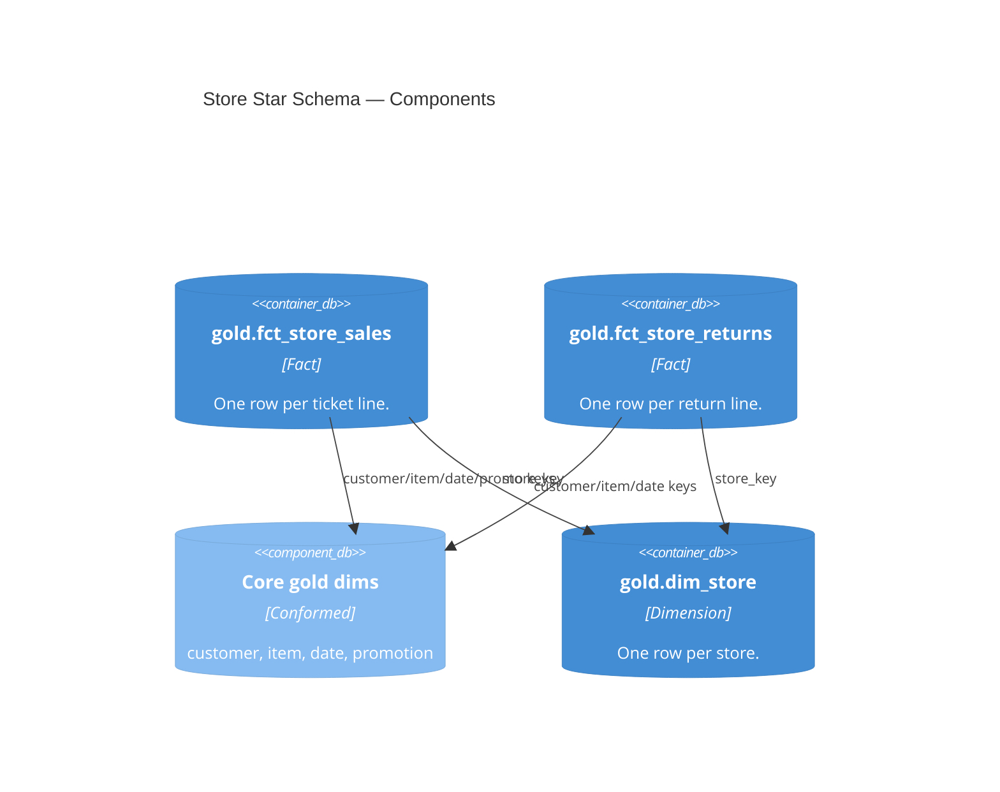

# Gold — Star Schema (Store)

| module | component | entities | tables |
|---|---|---|---|
| [store_sales](../../modules/store_sales.md) | gold | FctStoreSales · FctStoreReturns · DimStore | [gold.fct_store_sales](../../reference/tables/gold.fct_store_sales.md) · [gold.fct_store_returns](../../reference/tables/gold.fct_store_returns.md) · [gold.dim_store](../../reference/tables/gold.dim_store.md) |

> **C4 Level 3 — Component.** The store star schema — sales and returns facts and the store dimension — that the governed Metric Views read directly, joined on surrogate keys.

## Entities

| Entity | Table(s) | Algorithm(s) | Description |
|---|---|---|---|
| `FctStoreSales` | [`gold.fct_store_sales`](../../reference/tables/gold.fct_store_sales.md) | — | Conformed sales fact. Grain: one ticket line. |
| `FctStoreReturns` | [`gold.fct_store_returns`](../../reference/tables/gold.fct_store_returns.md) | — | Conformed returns fact. Grain: one return line. |
| `DimStore` | [`gold.dim_store`](../../reference/tables/gold.dim_store.md) | — | Store dimension (store-domain only). |

Each entity is one SQL file in `src/store_sales/gold/`. The store dimension is owned by this
pipeline; the facts read the conformed core gold dims across pipelines. The governed Metric
Views read these facts and dimensions directly, joined on surrogate keys.
