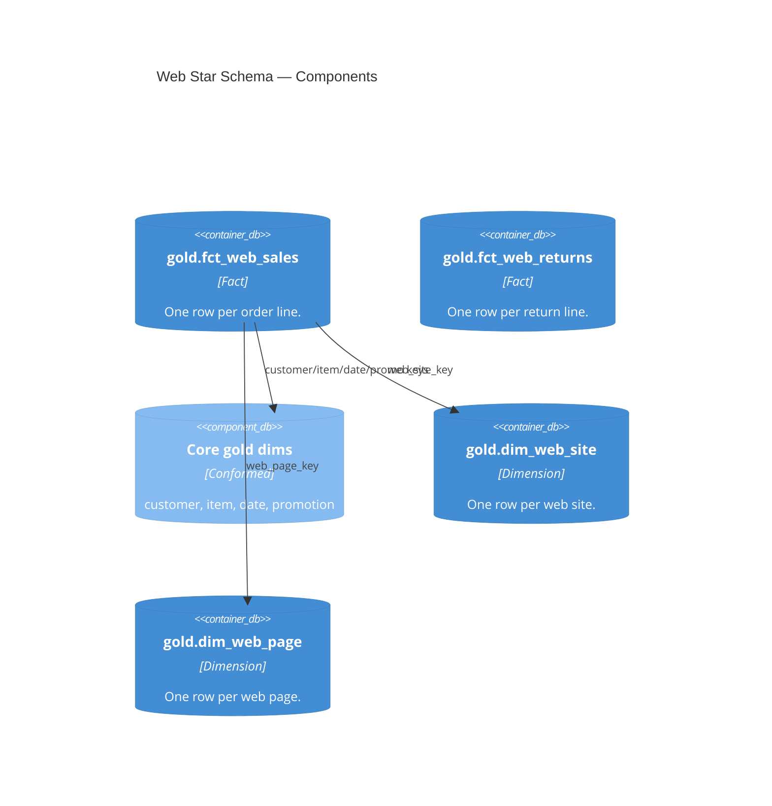

# Gold — Star Schema and Consumption Table (Web)

| module | component | entities | tables |
|---|---|---|---|
| [web_sales](../../modules/web_sales.md) | gold | FctWebSales · FctWebReturns · DimWebSite · DimWebPage · WebSalesEnriched | [gold.fct_web_sales](../../reference/tables/gold.fct_web_sales.md) · [gold.web_sales_enriched](../../reference/tables/gold.web_sales_enriched.md) |

> **C4 Level 3 — Component.** The web star schema (sales and returns facts, two web dims) plus the wide `web_sales_enriched` table the Metric View reads.

## Entities

| Entity | Table(s) | Algorithm(s) | Description |
|---|---|---|---|
| `FctWebSales` | [`gold.fct_web_sales`](../../reference/tables/gold.fct_web_sales.md) | — | Conformed sales fact. Grain: one order line. |
| `FctWebReturns` | [`gold.fct_web_returns`](../../reference/tables/gold.fct_web_returns.md) | — | Conformed returns fact. Grain: one return line. |
| `DimWebSite` | [`gold.dim_web_site`](../../reference/tables/gold.dim_web_site.md) | — | Web-site dimension. |
| `DimWebPage` | [`gold.dim_web_page`](../../reference/tables/gold.dim_web_page.md) | — | Web-page dimension. |
| `WebSalesEnriched` | [`gold.web_sales_enriched`](../../reference/tables/gold.web_sales_enriched.md) | — | Sales fact widened with core dims and the web dims; read by the Metric View and Genie with no joins. |

Each entity is one SQL file in `src/web_sales/gold/`. The enriched table reads the core
gold dims across pipelines; the web dims are owned by this pipeline.
