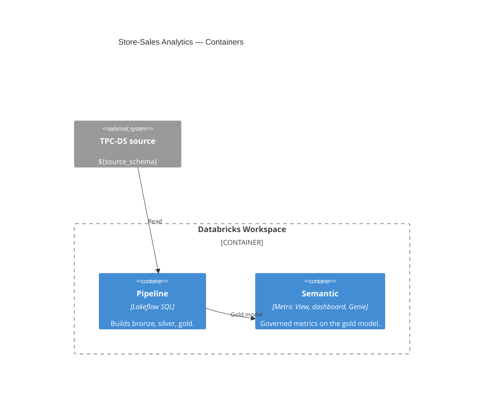

# Modules (L2 — Containers)

↑ [System Context](../README.md) &nbsp;|&nbsp; ↓ [Components](../components/README.md)

> **C4 Level 2 — Containers.** The system's two modules and how they relate: the pipeline that builds the model, and the semantic layer that governs the metrics over it.

| Module | Role | Databases |
|---|---|---|
| [pipeline](./pipeline.md) | Builds the store-sales model through the medallion. | `bronze`, `silver`, `gold` |
| [semantic](./semantic.md) | Governs the metrics and serves the dashboard and Genie. | `gold` |
