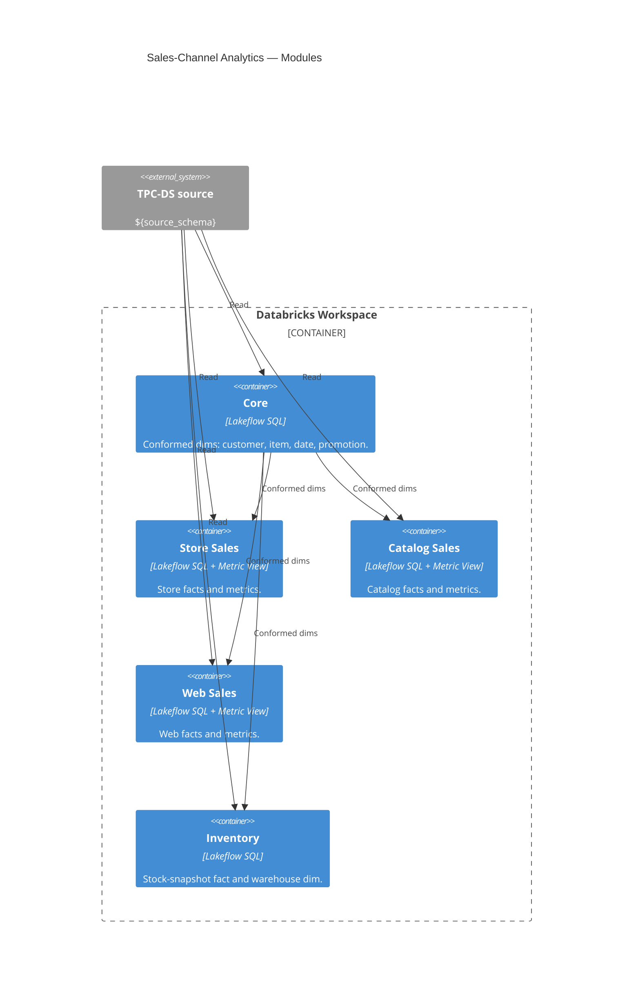

# Modules (L2)

↑ [System Context](../README.md) &nbsp;|&nbsp; ↓ [Components](../components/README.md)

> **C4 Level 2 — Modules.** One core pipeline builds the conformed dimensions once; three sales-channel domains build their facts and read those shared dims.

| Module | Role | Databases |
|---|---|---|
| [core](./core.md) | Builds the conformed dimensions once, read by every channel. | `bronze`, `silver`, `gold` |
| [store_sales](./store_sales.md) | Store sales-channel facts, the store dimension, and the governed Metric Views. | `bronze`, `silver`, `gold` |
| [catalog_sales](./catalog_sales.md) | Catalog sales-channel facts, catalog dimensions, and the governed Metric Views. | `bronze`, `silver`, `gold` |
| [web_sales](./web_sales.md) | Web sales-channel facts, web dimensions, and the governed Metric Views. | `bronze`, `silver`, `gold` |
| [inventory](./inventory.md) | Periodic stock-snapshot fact and the warehouse dimension. | `bronze`, `silver`, `gold` |

**Semantic view.** The build diagram above shows which pipeline builds which module.
The business objects and the links between them — the ontology — are the object graph in
the [gold-table reference](../reference/tables/README.md#object-graph-ontology).
