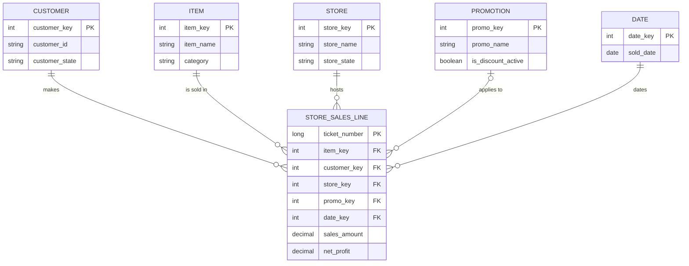

# Modules (L2 — Containers)

↑ [System Context](../README.md) &nbsp;|&nbsp; ↓ [Components](../components/README.md)

> **C4 Level 2 — Containers.** One core pipeline builds the conformed dimensions once; three sales-channel domains build their facts and read those shared dims.

| Module | Role | Databases |
|---|---|---|
| [core](./core.md) | Builds the conformed dimensions once, read by every channel. | `bronze`, `silver`, `gold` |
| [store_sales](./store_sales.md) | Store sales-channel facts, enriched table, and Metric View. | `bronze`, `silver`, `gold` |
| [catalog_sales](./catalog_sales.md) | Catalog sales-channel facts, enriched table, and Metric View. | `bronze`, `silver`, `gold` |
| [web_sales](./web_sales.md) | Web sales-channel facts, enriched table, and Metric View. | `bronze`, `silver`, `gold` |
| [inventory](./inventory.md) | Periodic stock-snapshot fact and the warehouse dimension. | `bronze`, `silver`, `gold` |

## Object graph (ontology)

The diagram above is the **build view**: which pipeline builds which container. This one is
the **semantic view**: the business objects and the links between them, in the Palantir
ontology style. An object type is a gold table; a link is a foreign key in the star schema;
the crow's-foot end shows the cardinality, and an open circle shows an optional link. Each
object's full properties, source-column lineage, and links live in its L4 table file.

| Object type | Gold table | Built by |
|---|---|---|
| Customer | [`gold.dim_customer`](../reference/tables/gold.dim_customer.md) | core |
| Item | [`gold.dim_item`](../reference/tables/gold.dim_item.md) | core |
| Store | [`gold.dim_store`](../reference/tables/gold.dim_store.md) | store_sales |
| Promotion | [`gold.dim_promotion`](../reference/tables/gold.dim_promotion.md) | core |
| Date | [`gold.dim_date`](../reference/tables/gold.dim_date.md) | core |
| Store-Sales Line | [`gold.fct_store_sales`](../reference/tables/gold.fct_store_sales.md) | store_sales |
