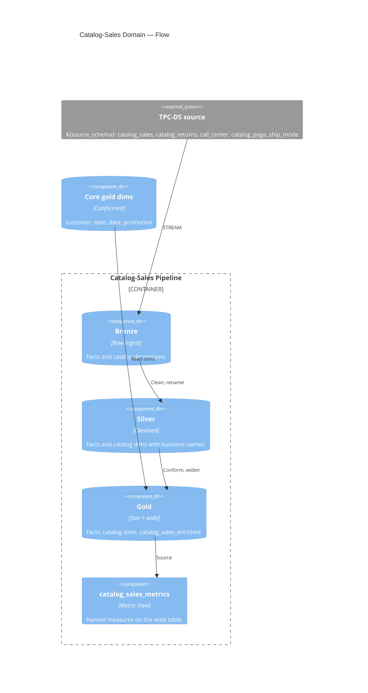

# Catalog Sales — Channel Domain

↑ [System Context](../README.md) &nbsp;|&nbsp; ← [Modules](./README.md)

| module | database | entry point |
|---|---|---|
| [catalog_sales](./catalog_sales.md) | `bronze` · `silver` · `gold` | [catalog_sales_pipeline.yml](../../resources/catalog_sales_pipeline.yml) |

> **C4 Level 2 — Container.** The catalog sales-channel domain: the catalog-sales and catalog-returns facts, the catalog-only dimensions, the wide enriched table, and the governed Metric View.

The catalog domain builds its facts and the call-center, catalog-page, and ship-mode
dimensions, then reads the conformed core dims (customer, item, date, promotion) to widen
the fact into `gold.catalog_sales_enriched`. `Net Sales` and `Quantity Sold` mean the same
here as in the store and web domains; the transaction count is `Order Count`.

## Components

| Component | What it builds |
|---|---|
| [bronze](../components/catalog_sales/bronze.md) | Raw streaming copies of the catalog facts and catalog dimensions. |
| [silver](../components/catalog_sales/silver.md) | Cleansed catalog-sales and catalog-returns facts and the catalog dims. |
| [gold](../components/catalog_sales/gold.md) | The star schema and the wide `catalog_sales_enriched` table. |
| [metrics](../components/catalog_sales/metrics.md) | The governed catalog-sales Metric View. |
