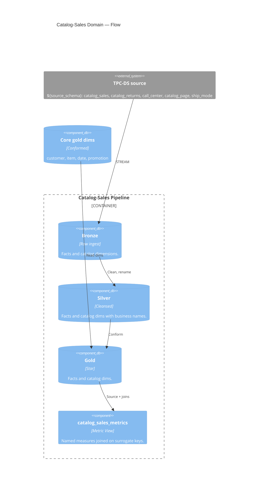

# Catalog Sales — Channel Domain

↑ [System Context](../README.md) &nbsp;|&nbsp; ← [Modules](./README.md)

| module | database | entry point |
|---|---|---|
| [catalog_sales](./catalog_sales.md) | `bronze` · `silver` · `gold` | [catalog_sales_pipeline.yml](../../resources/catalog_sales_pipeline.yml) |

> **C4 Level 2 — Module.** The catalog sales-channel domain: the catalog-sales and catalog-returns facts, the catalog-only dimensions, and the governed Metric Views.

The catalog domain builds its facts and the call-center, catalog-page, and ship-mode
dimensions, then reads the conformed core dims (customer, item, date, promotion). The
governed Metric Views read the gold star schema directly, joined on surrogate keys. `Gross
Sales` and `Sales Quantity` mean the same here as in the store and web domains.

## Components

| Component | What it builds |
|---|---|
| [bronze](../components/catalog_sales/bronze.md) | Raw streaming copies of the catalog facts and catalog dimensions. |
| [silver](../components/catalog_sales/silver.md) | Cleansed catalog-sales and catalog-returns facts and the catalog dims. |
| [gold](../components/catalog_sales/gold.md) | The catalog star schema: facts and catalog dims. |
| [metrics](../components/catalog_sales/metrics.md) | The governed catalog-sales and catalog-returns Metric Views. |
