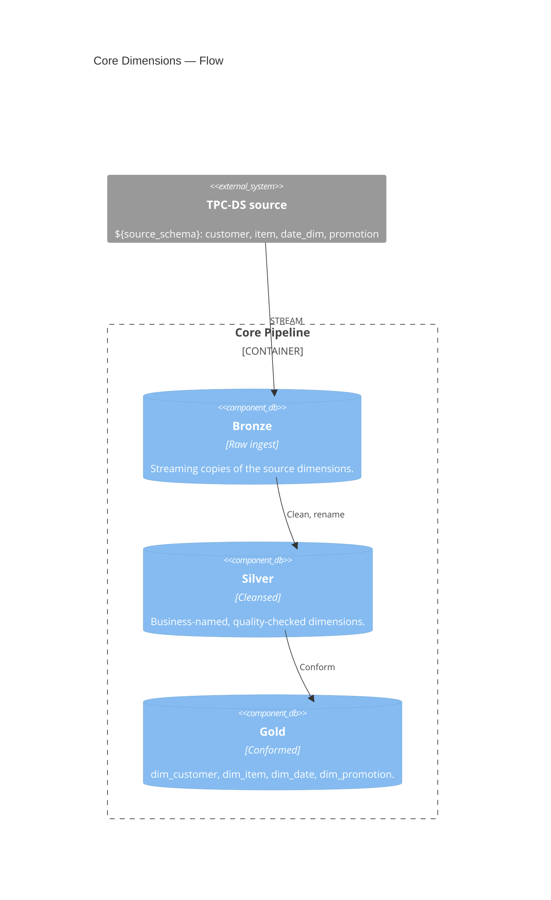

# Core — Conformed Dimensions

↑ [System Context](../README.md) &nbsp;|&nbsp; ← [Modules](./README.md)

| module | database | entry point |
|---|---|---|
| [core](./core.md) | `bronze` · `silver` · `gold` | [core_pipeline.yml](../../resources/core_pipeline.yml) |

> **C4 Level 2 — Container.** The Lakeflow Declarative Pipeline that builds the conformed dimensions once — customer, item, date, promotion — read by every sales-channel domain.

Core is the shared semantic foundation under the three sales channels. It builds the
dimensions once, through bronze, silver, and gold, and the store, catalog, and web pipelines
read its gold dims. A dimension table is owned by this one pipeline; no channel rebuilds it.

## Components

| Component | What it builds |
|---|---|
| [bronze](../components/core/bronze.md) | Raw streaming copies of the shared TPC-DS dimension tables. |
| [silver](../components/core/silver.md) | Cleansed, business-named conformed dimensions. |
| [gold](../components/core/gold.md) | The conformed `dim_customer`, `dim_item`, `dim_date`, `dim_promotion`. |
