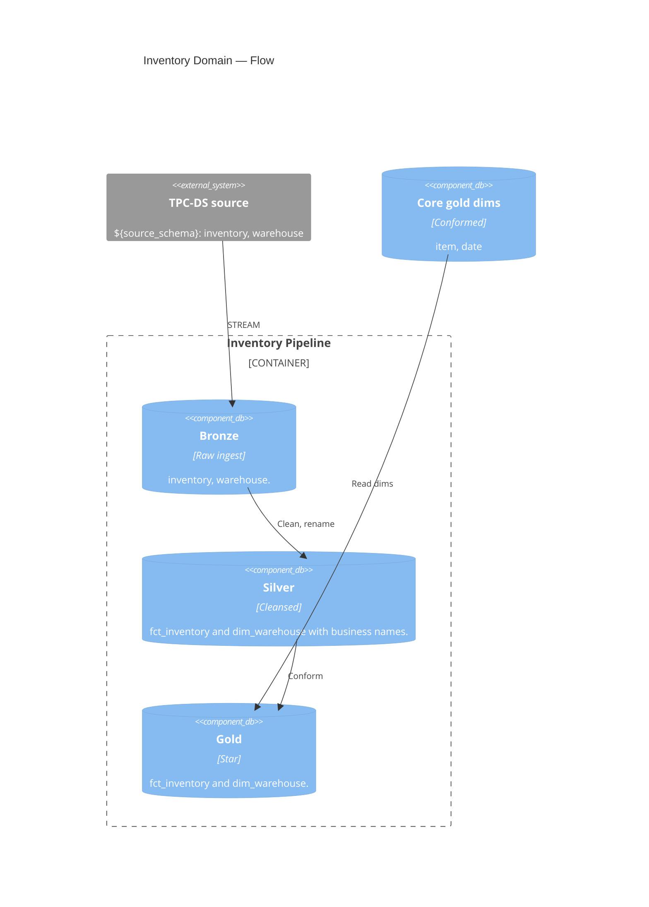

# Inventory — Stock Snapshot Domain

↑ [System Context](../README.md) &nbsp;|&nbsp; ← [Modules](./README.md)

| module | database | entry point |
|---|---|---|
| [inventory](./inventory.md) | `bronze` · `silver` · `gold` | [inventory_pipeline.yml](../../resources/inventory_pipeline.yml) |

> **C4 Level 2 — Container.** The inventory domain: TPC-DS's one non-sales fact, a periodic stock snapshot over item, warehouse, and date, plus the warehouse dimension.

Inventory is the demo's second fact subject area beyond sales. It builds the warehouse
dimension and the `fct_inventory` periodic-snapshot fact through bronze, silver, and gold,
then reads the conformed item and date gold dims built by the core pipeline. The fact grain
is one item × warehouse × date snapshot of quantity on hand. A dimension table is owned by
exactly one pipeline: this pipeline owns `dim_warehouse` only; it reads `gold.dim_item` and
`gold.dim_date`, it never rebuilds them.

## Components

| Component | What it builds |
|---|---|
| [bronze](../components/inventory/bronze.md) | Raw streaming copies of the inventory and warehouse tables. |
| [silver](../components/inventory/silver.md) | Cleansed inventory fact and the warehouse dimension. |
| [gold](../components/inventory/gold.md) | The inventory star: `fct_inventory` and `dim_warehouse`. |
