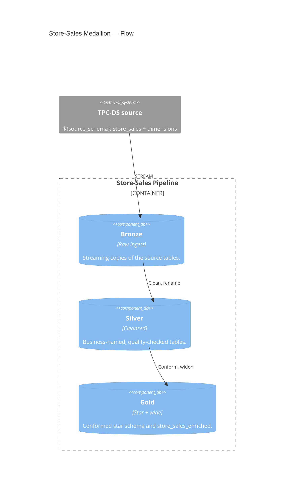

# Pipeline — Store-Sales Medallion

↑ [System Context](../README.md) &nbsp;|&nbsp; ← [Modules](./README.md)

| module | database | entry point |
|---|---|---|
| [pipeline](./pipeline.md) | `bronze` · `silver` · `gold` | [store_sales_pipeline.yml](../../resources/store_sales_pipeline.yml) |

> **C4 Level 2 — Container.** The Lakeflow Declarative Pipeline that builds the store-sales model through bronze, silver, and gold, one SQL file per table.

The pipeline reads the TPC-DS source schema (`${source_schema}`) and writes three Unity
Catalog schemas in order: raw ingest, cleansed business-named tables, then the conformed
star schema and the wide consumption table.

## Components

| Component | What it builds |
|---|---|
| [bronze](../components/pipeline/bronze.md) | Raw streaming copies of the TPC-DS source tables. |
| [silver](../components/pipeline/silver.md) | Cleansed, business-named dimensions and the store-sales fact. |
| [gold](../components/pipeline/gold.md) | The star schema and the wide `store_sales_enriched` table. |
