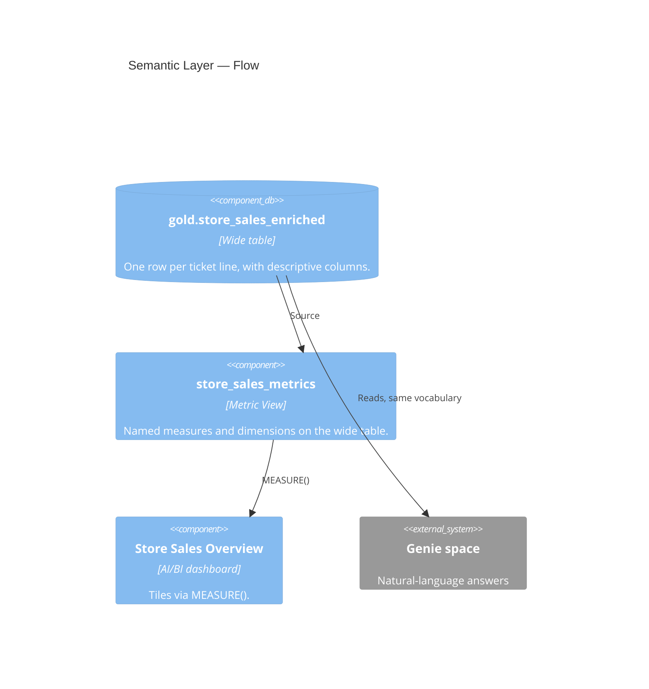

# Semantic — Governed Metrics and Consumption

↑ [System Context](../README.md) &nbsp;|&nbsp; ← [Modules](./README.md)

| module | database | entry point |
|---|---|---|
| [semantic](./semantic.md) | `gold` | [store_sales_metrics.md](../reference/metrics_views/store_sales_metrics.md) |

> **C4 Level 2 — Container.** The governed Metric View over the gold model, and the dashboard and Genie space that read it with one shared vocabulary.

The semantic layer turns the gold model into governed business metrics. It reads one table,
`gold.store_sales_enriched`, so there are no joins to reason about. Every measure and
dimension name matches the ontology, the Genie instructions, and the dashboard tiles.

## Components

| Component | What it governs |
|---|---|
| [store-sales-metrics](../components/semantic/store-sales-metrics.md) | The named store-sales metrics and the Metric View that serves them. |
