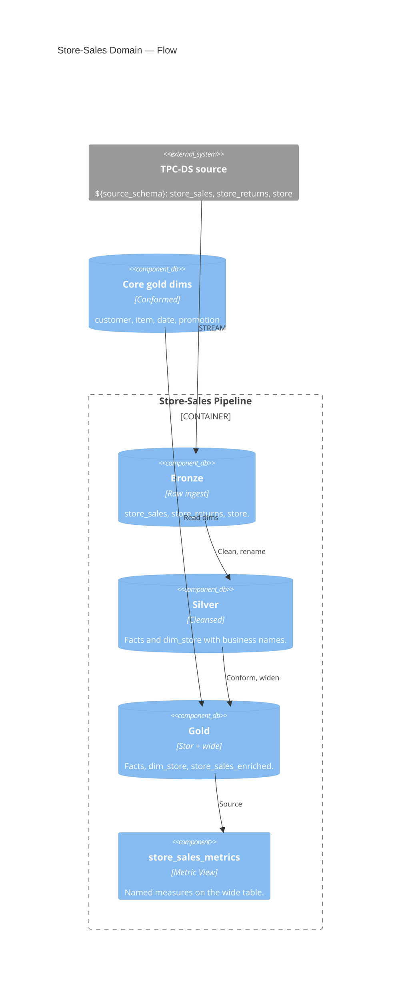

# Store Sales — Channel Domain

↑ [System Context](../README.md) &nbsp;|&nbsp; ← [Modules](./README.md)

| module | database | entry point |
|---|---|---|
| [store_sales](./store_sales.md) | `bronze` · `silver` · `gold` | [store_sales_pipeline.yml](../../resources/store_sales_pipeline.yml) |

> **C4 Level 2 — Container.** The store sales-channel domain: the store-sales and store-returns facts, the store dimension, the wide enriched table, and the governed Metric View.

The store domain builds its facts and the store dimension, then reads the conformed core
dims (customer, item, date, promotion) to widen the fact into `gold.store_sales_enriched`.
The Metric View and Genie read that one table. `Net Sales` and `Quantity Sold` mean the same
here as in the catalog and web domains.

## Components

| Component | What it builds |
|---|---|
| [bronze](../components/store_sales/bronze.md) | Raw streaming copies of the store-sales, store-returns, and store tables. |
| [silver](../components/store_sales/silver.md) | Cleansed store-sales and store-returns facts and the store dimension. |
| [gold](../components/store_sales/gold.md) | The star schema and the wide `store_sales_enriched` table. |
| [metrics](../components/store_sales/metrics.md) | The governed store-sales Metric View. |
