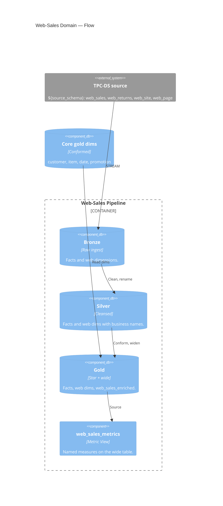

# Web Sales — Channel Domain

↑ [System Context](../README.md) &nbsp;|&nbsp; ← [Modules](./README.md)

| module | database | entry point |
|---|---|---|
| [web_sales](./web_sales.md) | `bronze` · `silver` · `gold` | [web_sales_pipeline.yml](../../resources/web_sales_pipeline.yml) |

> **C4 Level 2 — Container.** The web sales-channel domain: the web-sales and web-returns facts, the web-only dimensions, the wide enriched table, and the governed Metric View.

The web domain builds its facts and the web-site and web-page dimensions, then reads the
conformed core dims (customer, item, date, promotion) to widen the fact into
`gold.web_sales_enriched`. `Net Sales` and `Quantity Sold` mean the same here as in the
store and catalog domains; the transaction count is `Order Count`, as in catalog.

## Components

| Component | What it builds |
|---|---|
| [bronze](../components/web_sales/bronze.md) | Raw streaming copies of the web facts and web dimensions. |
| [silver](../components/web_sales/silver.md) | Cleansed web-sales and web-returns facts and the web dims. |
| [gold](../components/web_sales/gold.md) | The star schema and the wide `web_sales_enriched` table. |
| [metrics](../components/web_sales/metrics.md) | The governed web-sales Metric View. |
