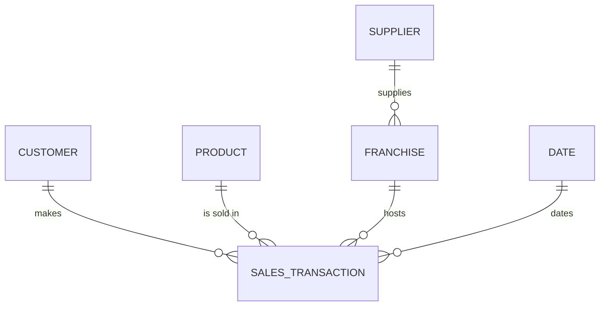

# Link Types

Links are how object types relate. Each link is a foreign key in the gold star schema,
so the ontology and the data model agree by construction.

| Link | From | To | Backed by key | Cardinality |
|---|---|---|---|---|
| makes | Customer | Sales Transaction | `customer_key` | one-to-many |
| is sold in | Product | Sales Transaction | `product_name` | one-to-many |
| hosts | Franchise | Sales Transaction | `franchise_key` | one-to-many |
| dates | Date | Sales Transaction | `sold_date` | one-to-many |
| supplies | Supplier | Franchise | `supplier_key` | one-to-many |

Date is a calendar object backed by `gold.dim_date`; it has no file in `object-types/`
because it carries no business metrics of its own, only the time grain.
