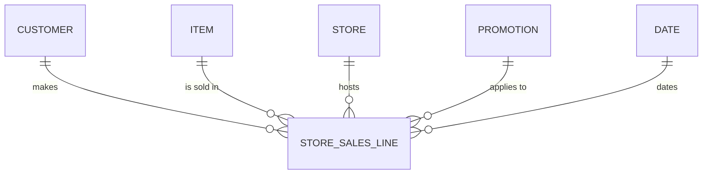

# Link Types

Links are how object types relate. Each link is a foreign key in the gold star schema, so
the ontology and the data model agree by construction.

| Link | From | To | Backed by key | Cardinality |
|---|---|---|---|---|
| makes | Customer | Store-Sales Line | `customer_key` | one-to-many |
| is sold in | Item | Store-Sales Line | `item_key` | one-to-many |
| hosts | Store | Store-Sales Line | `store_key` | one-to-many |
| applies to | Promotion | Store-Sales Line | `promo_key` | one-to-many (optional) |
| dates | Date | Store-Sales Line | `date_key` | one-to-many |

A store-sales line may carry no promotion (`promo_key` is null), so the "applies to" link is
optional. Date is a calendar object backed by `gold.dim_date`; it has no file in
`object-types/` because it carries no business metrics of its own, only the time grain.
