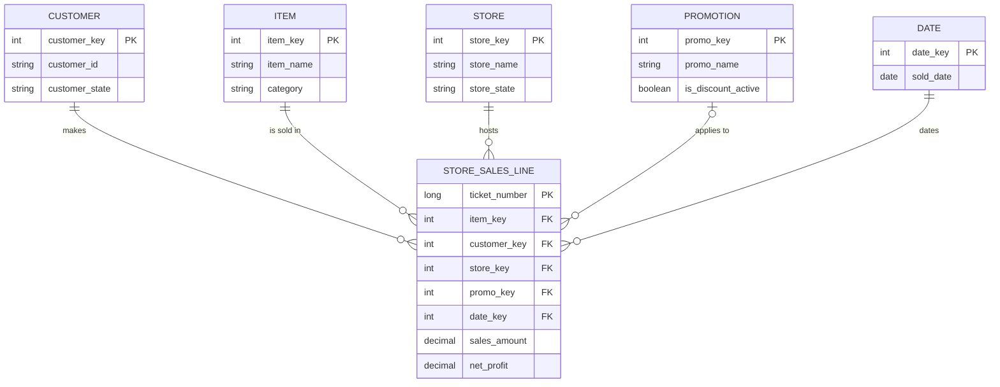
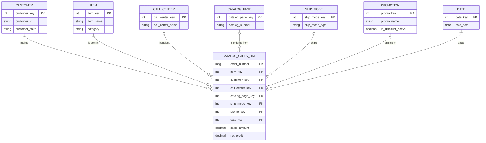
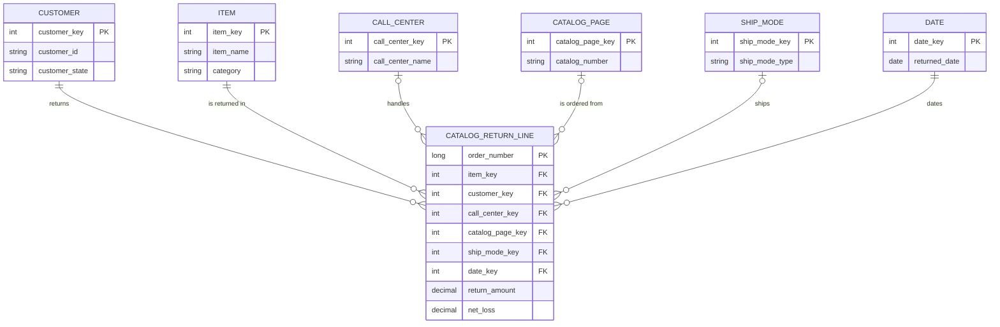

# Tables (L4 — Code)

↑ [System Context](../../README.md) &nbsp;|&nbsp; → [Metric Views](../metrics_views/README.md)

> **C4 Level 4 — Tables.** Column-level schemas of the gold star schema and the wide consumption table, and the ontology object graph over them. Each gold table is a business object; load one only when you need exact column names. Every gold table's business domain is in the [domains registry](../../domains/README.md).

## Object graph (ontology)

The **semantic view** of the gold tables: the business objects and the links between them, in
the Palantir ontology style. It is the counterpart to the build view in
[modules/](../../modules/README.md), which shows which pipeline builds which module. An object
type is a gold table; a link is a foreign key in the star schema; the crow's-foot end shows
the cardinality, and an open circle shows an optional link. Each object's full properties,
source-column lineage, and links live in its L4 table file below.

The model has seven fact stars, so the ontology is drawn as one **named view per fact**, not a
single crowded diagram. Three views are modelled today — **Store Sales**, **Catalog Sales**, and
**Catalog Returns** below. The other facts (Web Sales, Store Returns, Web Returns, and Inventory)
are gold tables but are not yet business objects: they carry no `object_type` or `## Links` yet, so
they have no view. Each gets its own named view when it is modelled. The views share the
conformed dimensions (Customer, Item, Date, Promotion), which is the point of the star schema.

### Store Sales

The store sales-channel star: the `Store-Sales Line` fact and the conformed dimensions it
links.

| Object type | Gold table | Built by |
|---|---|---|
| Customer | [`gold.dim_customer`](./gold.dim_customer.md) | core |
| Item | [`gold.dim_item`](./gold.dim_item.md) | core |
| Store | [`gold.dim_store`](./gold.dim_store.md) | store_sales |
| Promotion | [`gold.dim_promotion`](./gold.dim_promotion.md) | core |
| Date | [`gold.dim_date`](./gold.dim_date.md) | core |
| Store-Sales Line | [`gold.fct_store_sales`](./gold.fct_store_sales.md) | store_sales |

### Catalog Sales

The catalog sales-channel star: the `Catalog-Sales Line` fact and the dimensions it links. An
open circle marks an optional link (call center, catalog page, ship mode, promotion).

| Object type | Gold table | Built by |
|---|---|---|
| Customer | [`gold.dim_customer`](./gold.dim_customer.md) | core |
| Item | [`gold.dim_item`](./gold.dim_item.md) | core |
| Call Center | [`gold.dim_call_center`](./gold.dim_call_center.md) | catalog_sales |
| Catalog Page | [`gold.dim_catalog_page`](./gold.dim_catalog_page.md) | catalog_sales |
| Ship Mode | [`gold.dim_ship_mode`](./gold.dim_ship_mode.md) | catalog_sales |
| Promotion | [`gold.dim_promotion`](./gold.dim_promotion.md) | core |
| Date | [`gold.dim_date`](./gold.dim_date.md) | core |
| Catalog-Sales Line | [`gold.fct_catalog_sales`](./gold.fct_catalog_sales.md) | catalog_sales |

### Catalog Returns

The catalog-returns star: the `Catalog-Return Line` fact and the dimensions it links. An open
circle marks an optional link (call center, catalog page, ship mode).

| Object type | Gold table | Built by |
|---|---|---|
| Customer | [`gold.dim_customer`](./gold.dim_customer.md) | core |
| Item | [`gold.dim_item`](./gold.dim_item.md) | core |
| Call Center | [`gold.dim_call_center`](./gold.dim_call_center.md) | catalog_sales |
| Catalog Page | [`gold.dim_catalog_page`](./gold.dim_catalog_page.md) | catalog_sales |
| Ship Mode | [`gold.dim_ship_mode`](./gold.dim_ship_mode.md) | catalog_sales |
| Date | [`gold.dim_date`](./gold.dim_date.md) | core |
| Catalog-Return Line | [`gold.fct_catalog_returns`](./gold.fct_catalog_returns.md) | catalog_sales |

Core dimensions (built once, shared by all channels):

| Table | Role | Built from |
|---|---|---|
| [gold.dim_customer](./gold.dim_customer.md) | Dimension — one row per customer | `silver.dim_customer` |
| [gold.dim_item](./gold.dim_item.md) | Dimension — one row per item | `silver.dim_item` |
| [gold.dim_date](./gold.dim_date.md) | Dimension — one row per calendar day | `silver.dim_date` |
| [gold.dim_promotion](./gold.dim_promotion.md) | Dimension — one row per promotion | `silver.dim_promotion` |
| [gold.dim_time](./gold.dim_time.md) | Dimension — one row per second of the day | `silver.dim_time` |
| [gold.dim_reason](./gold.dim_reason.md) | Dimension — one row per return reason | `silver.dim_reason` |
| [gold.dim_customer_demographics](./gold.dim_customer_demographics.md) | Dimension — one row per demographic profile | `silver.dim_customer_demographics` |
| [gold.dim_household_demographics](./gold.dim_household_demographics.md) | Dimension — one row per household profile | `silver.dim_household_demographics` |
| [gold.dim_income_band](./gold.dim_income_band.md) | Dimension — one row per income band | `silver.dim_income_band` |

Store channel:

| Table | Role | Built from |
|---|---|---|
| [gold.fct_store_sales](./gold.fct_store_sales.md) | Fact — one store-sales ticket line | `silver.fct_store_sales` + dims |
| [gold.fct_store_returns](./gold.fct_store_returns.md) | Fact — one store-return line | `silver.fct_store_returns` + dims |
| [gold.dim_store](./gold.dim_store.md) | Dimension — one row per store | `silver.dim_store` |

Catalog channel:

| Table | Role | Built from |
|---|---|---|
| [gold.fct_catalog_sales](./gold.fct_catalog_sales.md) | Fact — one catalog-sales order line | `silver.fct_catalog_sales` + dims |
| [gold.fct_catalog_returns](./gold.fct_catalog_returns.md) | Fact — one catalog-return line | `silver.fct_catalog_returns` + dims |
| [gold.dim_call_center](./gold.dim_call_center.md) | Dimension — one row per call center | `silver.dim_call_center` |
| [gold.dim_catalog_page](./gold.dim_catalog_page.md) | Dimension — one row per catalog page | `silver.dim_catalog_page` |
| [gold.dim_ship_mode](./gold.dim_ship_mode.md) | Dimension — one row per ship mode | `silver.dim_ship_mode` |

Web channel:

| Table | Role | Built from |
|---|---|---|
| [gold.fct_web_sales](./gold.fct_web_sales.md) | Fact — one web-sales order line | `silver.fct_web_sales` + dims |
| [gold.fct_web_returns](./gold.fct_web_returns.md) | Fact — one web-return line | `silver.fct_web_returns` + dims |
| [gold.dim_web_site](./gold.dim_web_site.md) | Dimension — one row per web site | `silver.dim_web_site` |
| [gold.dim_web_page](./gold.dim_web_page.md) | Dimension — one row per web page | `silver.dim_web_page` |

Inventory:

| Table | Role | Built from |
|---|---|---|
| [gold.fct_inventory](./gold.fct_inventory.md) | Fact — one item × warehouse × date stock snapshot | `silver.fct_inventory` + dims |
| [gold.dim_warehouse](./gold.dim_warehouse.md) | Dimension — one row per warehouse | `silver.dim_warehouse` |
